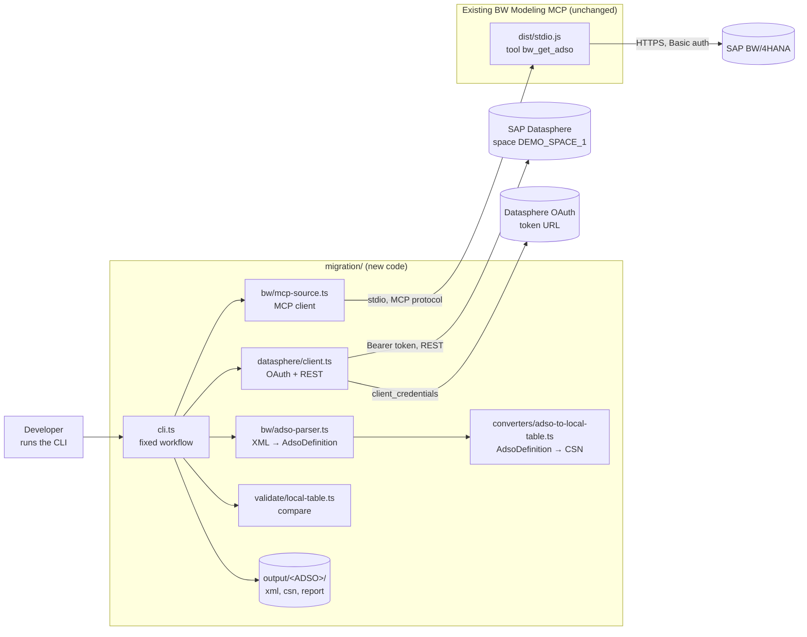
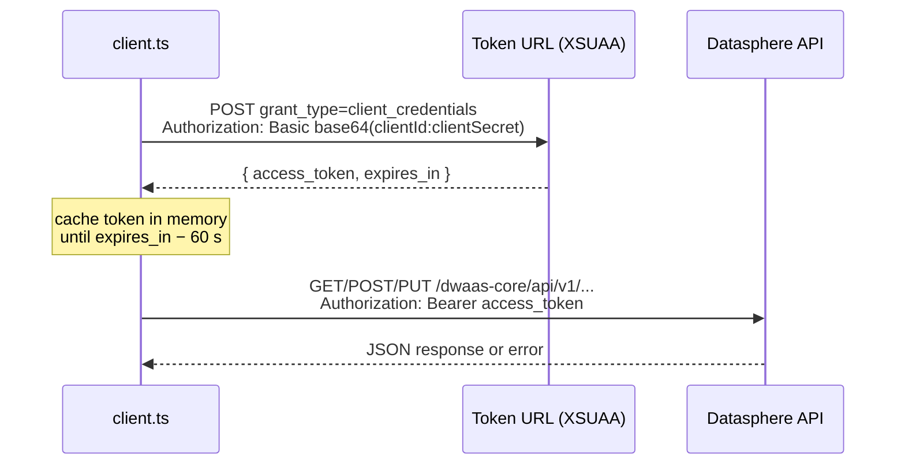
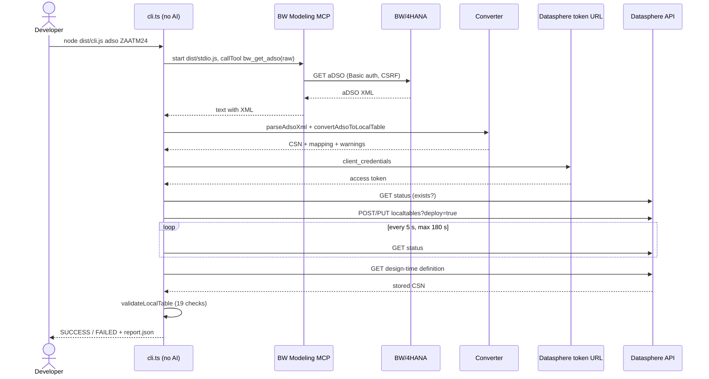

# SAP BW → SAP Datasphere Migration POC

A complete A-to-Z guide to what we built, where it lives, how it works, and what is still missing.

> **How to read this document.** Every statement is marked or worded as one of:
> **Verified** (checked in code or proven by a real run), **Not verified** (we could not confirm it),
> or **Planned** (not built yet). No real secrets appear here. Placeholders look like `<client secret>`.

---

## Contents

1. [Project Overview](#1-project-overview)
2. [Project Goals](#2-project-goals)
3. [Current Status](#3-current-status)
4. [Technology Stack](#4-technology-stack)
5. [Architecture Diagram](#5-architecture-diagram)
6. [End-to-End Workflow](#6-end-to-end-workflow)
7. [Authentication and Authorization](#7-authentication-and-authorization)
8. [Configuration and Secret Management](#8-configuration-and-secret-management)
9. [Naming Conventions and Key Handling](#9-naming-conventions-and-key-handling)
10. [BW-to-Datasphere Mapping Rules](#10-bw-to-datasphere-mapping-rules)
11. [Object Creation and Deployment](#11-object-creation-and-deployment)
12. [Completed aDSO Migration Example](#12-completed-adso-migration-example)
13. [File-by-File Code Guide](#13-file-by-file-code-guide)
14. [AI Prompt and Tool Execution Flow](#14-ai-prompt-and-tool-execution-flow)
15. [Validation and Error Handling](#15-validation-and-error-handling)
16. [Installation and Setup](#16-installation-and-setup)
17. [How to Run a Migration](#17-how-to-run-a-migration)
18. [Testing and Validation Results](#18-testing-and-validation-results)
19. [Troubleshooting](#19-troubleshooting)
20. [Known Limitations](#20-known-limitations)
21. [Missing Features and Risk Analysis](#21-missing-features-and-risk-analysis)
22. [Next Steps and Roadmap](#22-next-steps-and-roadmap)
23. [Glossary of Technical Terms](#23-glossary-of-technical-terms)

---

## 1. Project Overview

### The short version

We built a small tool that **copies the structure of a BW aDSO into SAP Datasphere as a Local Table**.

- It **reads** the aDSO from BW using the existing **BW Modeling MCP** server.
- It **converts** the BW definition into the format Datasphere understands.
- It **creates and deploys** the table in Datasphere through Datasphere's REST API.
- It **reads the table back** and checks that it matches BW.

We proved it with one real object: BW aDSO `ZAATM24` became Datasphere table `MIG_ZAATM24`.

### The basic terms

| Term | Simple explanation |
|---|---|
| **SAP BW/4HANA** | SAP's on-premise data warehouse. Companies use it to collect and report on business data. Our source system. |
| **SAP Datasphere** | SAP's cloud data warehouse, the successor direction for many BW customers. Our target system. |
| **aDSO** (advanced DataStore Object) | The main BW object that stores data. Think of it as a database table with extra BW behavior: a key, key figures (numbers), change log, request handling. |
| **Local Table** | A normal table that lives inside a Datasphere space. It is the closest Datasphere object to an aDSO's structure. |
| **MCP** (Model Context Protocol) | A standard way for an AI assistant (or any program) to call "tools" on a server. A tool is a function with a name and parameters, for example `bw_get_adso(adso_name)`. |
| **BW Modeling MCP** | The existing open-source MCP server in this repository (`../src`). It talks to BW and offers 108 tools to read and change BW objects. |
| **CSN** (Core Schema Notation) | A JSON format SAP uses to describe tables, views and models. Datasphere accepts CSN to create objects. |

### Why a conversion layer is needed

BW and Datasphere describe tables differently.

- BW says `CHAR 10`, `DATS`, `CURR 11,2`, "key figure with currency KONWA".
- Datasphere says `cds.String(10)`, `cds.Date`, `cds.Decimal(11,2)`, `@Semantics.amount.currencyCode`.

Something must translate one into the other. That is the **conversion layer**.
It is plain, deterministic code: the same input always gives the same output.

### Why we reuse the BW Modeling MCP

The BW Modeling MCP already knows how to log in to BW, handle CSRF tokens, sessions, and read every
BW object type. Rebuilding that would take weeks and add risk. So we **use it unchanged**, as the
"read side" of the migration. We only call its public tools, like any other MCP client would.

---

## 2. Project Goals

1. **Automate** the move of BW objects to Datasphere, as far as SAP's APIs allow.
2. **One object type at a time.** Start with aDSO. Make it work end to end. Then add the next type.
3. **Do not rebuild BW access.** The BW Modeling MCP stays the source side.
4. **Prove every step.** After creating an object, read it back and compare it with BW.
5. **Be safe in a shared space.** Never overwrite someone else's object.

The planned order of object types (see [Roadmap](#22-next-steps-and-roadmap)):

```
aDSO (done) → InfoObject → CompositeProvider → Query → Transformation / DTP → Process Chain
```

---

## 3. Current Status

| Area | Status |
|---|---|
| Analysis of BW MCP tools and Datasphere APIs | ✅ Done |
| Datasphere connectivity (OAuth technical user) | ✅ Verified |
| Datasphere permissions on `DEMO_SPACE_1` | ✅ Verified (after a role fix, see [7.6](#76-how-the-http-403-was-solved)) |
| aDSO → Local Table converter | ✅ Implemented and tested |
| Create + deploy in Datasphere | ✅ Verified with `ZAATM24` |
| Read-back validation | ✅ 19 / 19 checks passed for `ZAATM24` |
| Unit tests | ✅ 13 / 13 pass |
| **Data load** (moving the rows) | ❌ Not implemented |
| Master-data associations (InfoObjects) | ❌ Not implemented |
| Delta capture (change log equivalent) | ❌ Not implemented |
| Other object types | ❌ Planned |
| Production readiness | ❌ Not ready (POC only) |

> **Correction.** Earlier status messages said "18 of 18 checks". The saved report
> (`output/ZAATM24/report.json`) contains **19** checks, all passed. 19 is the correct number.
> The breakdown is in [section 12](#12-completed-adso-migration-example).

---

## 4. Technology Stack

| Part | Technology | Version (verified) |
|---|---|---|
| Runtime | Node.js | v22.21.1 on the dev machine; `package.json` requires `>=22.0.0` |
| Language | TypeScript, compiled with `tsc` | TypeScript 5.x from the root `node_modules` |
| MCP client | `@modelcontextprotocol/sdk` | 1.29.0 |
| XML parsing | `fast-xml-parser` | 4.5.5 |
| HTTP to Datasphere | Built-in `fetch` (Node 22) | — |
| Tests | Built-in `node:test` | — |
| Source system | SAP BW/4HANA (`bw.b4hanamode = STRICT`, logical system `BTPCLNT100`) | Verified with `bw_system_profile` |
| Target system | SAP Datasphere tenant `teklink-tdd-bdc-datasphere01`, region `us10` | Verified |
| Datasphere API | Modeling API `/dwaas-core/api/v1` (same API the official `datasphere` CLI uses) | Verified from the CLI's discovery document |

The migration module adds **no new npm packages**. It reuses the packages already installed in the
repository root.

---

## 5. Architecture Diagram



### What each box does

| Component | Job in one sentence |
|---|---|
| `cli.ts` | Runs the five steps in a fixed order and prints the result. |
| `mcp-source.ts` | Starts the BW MCP server as a child process and calls its `bw_get_adso` tool. |
| BW MCP (`../dist/stdio.js`) | Logs in to BW and returns the aDSO definition as XML. **Not changed by us.** |
| `adso-parser.ts` | Turns the XML into a clean TypeScript object (`AdsoDefinition`). |
| `adso-to-local-table.ts` | Turns `AdsoDefinition` into a Datasphere CSN table definition. |
| `datasphere/client.ts` | Gets an OAuth token and calls the Datasphere REST API. |
| `local-table.ts` (validate) | Compares what Datasphere stored with what BW has. |
| `output/` | Keeps the evidence of every run. |

---

## 6. End-to-End Workflow

### Does the real code follow the "AI-driven" 10-step flow?

**No, not exactly.** The migration CLI is a **fixed program**. No AI model runs inside it.
Here is the honest comparison:

| # | Suggested step | Exists in our code? | Where |
|---|---|---|---|
| 1 | User enters a natural-language prompt | ❌ No. The user runs a command: `node dist/cli.js adso ZAATM24` | `cli.ts` → `main()` |
| 2 | AI interprets the request | ❌ No AI in the migration CLI | — |
| 3 | Application selects MCP tools | ⚠️ Fixed, not selected: always `bw_get_adso` | `mcp-source.ts` → `getAdsoXml()` |
| 4 | BW MCP reads metadata from BW | ✅ Yes | `mcp-source.ts` → BW MCP `bw_get_adso` |
| 5 | Conversion to Datasphere format | ✅ Yes, deterministic code | `adso-to-local-table.ts` → `convertAdsoToLocalTable()` |
| 6 | Validate the converted definition | ⚠️ Partly: name checks, type checks, clash checks during conversion. No separate pre-check step. | `convertAdsoToLocalTable()` |
| 7 | Authenticate with Datasphere | ✅ Yes, OAuth client credentials | `client.ts` → `accessToken()` |
| 8 | Create or update the object | ✅ Yes (POST or PUT) | `client.ts` → `createLocalTable()` / `updateLocalTable()` |
| 9 | Read back and validate | ✅ Yes | `client.ts` → `getLocalTable()`, `local-table.ts` → `validateLocalTable()` |
| 10 | Return a report | ✅ Yes, console output + `report.json` | `cli.ts` → `migrateAdso()` |

### The real flow, step by step

```
node dist/cli.js adso ZAATM24
   │
   ├─[1/5] Read     BwMcpSource.connect() → getAdsoXml("ZAATM24") → close()
   │                 save output/ZAATM24/bw-source.xml
   │                 parseAdsoXml(xml)  →  AdsoDefinition
   │                 classifyAdso(xml)  →  "standard"   (reuses BW MCP logic)
   │
   ├─[2/5] Convert  convertAdsoToLocalTable(adso, {prefix: "MIG_"})
   │                 save output/ZAATM24/MIG_ZAATM24.csn.json
   │                 (stop here if --dry-run)
   │
   ├─[3/5] Create   localTableStatus("MIG_ZAATM24")  → exists?  stop unless --overwrite
   │                 POST (new) or PUT (existing) with ?deploy=true|false
   │
   ├─[4/5] Deploy   waitForLocalTable() polls status every 5 s, max 180 s
   │
   └─[5/5] Validate getLocalTable(design-time) → save MIG_ZAATM24.datasphere.json
                     validateLocalTable() → 19 checks → report.json → SUCCESS / FAILED
```

---

## 7. Authentication and Authorization

**Authentication** = proving who you are (login).
**Authorization** = what you are allowed to do after login (roles and permissions).
We need both, on both systems.

### 7.1 BW/4HANA authentication

| Question | Answer | Where |
|---|---|---|
| Method | HTTP **Basic authentication** (user + password), plus SAP client and CSRF token handling | `../src/bw-client.ts` (existing BW MCP) |
| Where credentials come from | `BW_URL`, `BW_USER`, `BW_PASSWORD`, `BW_CLIENT`, `BW_LANGUAGE` | Env block of the `bw-modeling` server in `../.mcp.json`, or `BW_*` environment variables |
| How the migration passes them | `loadBwEnv()` reads them and gives them to the child process that runs the BW MCP | `src/config.ts` → `loadBwEnv()`, `src/bw/mcp-source.ts` → `connect()` |
| Who builds the `Authorization` header | The BW MCP, not our code | `../src/bw-client.ts` (around line 426: `{ Authorization: this.basicAuth }`) |
| CSRF token | Fetched and resent by the BW MCP | `../src/bw-client.ts` (reads `x-csrf-token`) |
| Other modes | Cookie file (`BW_COOKIE_FILE`) or principal propagation on BTP. Not used in this POC. | `../README.md` |

> Our migration code **never** builds a BW auth header itself. That is a deliberate reuse.

### 7.2 Datasphere authentication: OAuth 2.0 client credentials

**OAuth client credentials** means: a program logs in with a *client ID* and *client secret* (like a
username and password for an application), receives a short-lived **access token**, and sends that
token with every API call.

Datasphere calls this kind of client an OAuth client with purpose **"Technical User"**. Our
technical user is `DSPMCPTECHUSER`.



| Step | What happens | Where (`src/datasphere/client.ts`) |
|---|---|---|
| Read config | `DSP_HOST`, `DSP_SPACE`, `DSP_CLIENT_ID`, `DSP_CLIENT_SECRET`, `DSP_TOKEN_URL` | `config.ts` → `loadDatasphereConfig()` |
| Request token | `POST <DSP_TOKEN_URL>`, body `grant_type=client_credentials`, header `Authorization: Basic base64(id:secret)` | `accessToken()` |
| Store token | In memory only, field `this.token = { value, expiresAt }` | `accessToken()` |
| Expiry | `expiresAt = now + (expires_in − 60 s)`. A new token is fetched when it has expired | `accessToken()` |
| Refresh | No refresh token. When expired, it simply asks for a new token (normal for client credentials) | `accessToken()` |
| Attach to calls | `Authorization: Bearer <token>`, plus `Accept` and `Content-Type: application/json` | `request()` |
| Token failure | Throws `DatasphereError("token request failed: HTTP <status>")` | `accessToken()` |
| Token rejected later (401) | **Not handled specially.** The call fails with the error. No automatic retry. | `request()` |

### 7.3 The Datasphere values and where they come from

| Value | Where we got it | Where it is stored |
|---|---|---|
| Tenant URL | Datasphere team (Rajat) | `DSP_HOST` in `migration/.env` |
| Space ID | Datasphere team | `DSP_SPACE` in `migration/.env` |
| Client ID / secret | Created by a Datasphere admin under *System → Administration → App Integration* | `DSP_CLIENT_ID` / `DSP_CLIENT_SECRET` in `migration/.env` |
| Token URL | Shown with the OAuth client | `DSP_TOKEN_URL` in `migration/.env` |

### 7.4 Authorization: roles and permissions

**Datasphere** (verified by testing):

| Needed for | Privilege | Notes |
|---|---|---|
| Any access | Data Warehouse General (Read) | |
| Create/read/update/delete tables | Data Warehouse Data Builder (CRUD) | |
| Write objects in the space | Space Files (CRUD) | |
| Which space | A **scoped role** whose scope includes `DEMO_SPACE_1`, **and** the technical user assigned to that space in the role | Both parts are needed |

The standard **DW Modeler** role template contains these privileges.

Some endpoints are blocked for technical users **by SAP design**, whatever the role:
`/users`, `/globalroles`, `/scopedroles` return `forbiddenOperationForTupOAuthClient`.
`spaces read` also returns 403 (it needs space-admin rights). **We do not need any of these.**

**BW**: the BW user (`BW_USER`) needs read authorization for the aDSO (BW modeling read). The
exact BW roles of the user are **Not verified**; the user could read `ZAATM24`, which proves it is
enough for this POC.

### 7.5 Secrets: where they are, and the risks

| Secret | Location | Risk | Recommendation |
|---|---|---|---|
| BW password | `../.mcp.json` (plain text) | Readable by anyone with file access. `.mcp.json` **is** listed in `../.gitignore`. | Move to an OS secret store or environment variable; rotate if the file was shared |
| Datasphere client secret | `migration/.env` (plain text) | Same. `.env` **is** git-ignored (`.env` rule in `../.gitignore`) | Use a secret store for anything beyond POC |
| Datasphere CLI cache | `~/.@sap/datasphere-cli/.cache/secrets.json` | Created when we tested the official CLI on day 1 | Run `datasphere logout` when no longer needed |
| Session scratch copy | A temporary file in the Claude Code session scratchpad (`dsp.env`) | Temporary folder | Delete it at the end of the POC |
| Chat history | The client secret was pasted into the AI chat | Outside our control | **Rotate the client secret after the POC** |
| Git history | This folder is **not** a Git repository, so there is no history to leak | — | When you put it in Git, keep `.env` and `.mcp.json` ignored |
| Logs and reports | **Verified:** `output/` files and console logs contain no secrets or tokens | — | Keep it that way |

### 7.6 How the HTTP 403 was solved

1. The token request worked (HTTP 200), so **authentication** was fine.
2. But every call into the space, e.g. `GET /dwaas-core/api/v1/spaces/DEMO_SPACE_1/localtables`,
   returned **HTTP 403 with an empty body**.
3. The `/users` and `/scopedroles` endpoints returned a *different* 403 with the code
   `forbiddenOperationForTupOAuthClient`. This told us technical users *are* allowed on the object
   endpoints in principle, and the empty 403 meant **missing authorization on the space**.
4. We asked Rajat to check that `DSPMCPTECHUSER` is in a scoped role whose scope includes
   `DEMO_SPACE_1` and that the role has DW Modeler privileges.
5. After his change, the same calls returned **HTTP 200**.

**Lesson:** an empty 403 on space endpoints usually means "the user is not assigned to this space
in a scoped role".

---

## 8. Configuration and Secret Management

### How configuration is loaded

- `src/config.ts` → `loadEnvFile()` loads `migration/.env` once, using Node's built-in
  `process.loadEnvFile()`. Values already in the environment are kept.
- `loadDatasphereConfig()` reads the `DSP_*` variables. A missing one stops the program with
  `"<NAME> is not set (migration/.env or environment) — see migration/.env.example"`.
- `loadBwEnv()` uses `BW_*` variables if `BW_URL` is set. Otherwise it reads the env block of the
  `bw-modeling` server in `../.mcp.json`.

### All configuration and keys

| Configuration or key | Purpose | Where it is defined | Example or format | Security considerations |
|---|---|---|---|---|
| `DSP_HOST` | Datasphere tenant URL | `migration/.env` | `https://<tenant>.<region>.hcs.cloud.sap` | Not secret |
| `DSP_SPACE` | Target space ID | `migration/.env` | `DEMO_SPACE_1` | Not secret |
| `DSP_CLIENT_ID` | OAuth client ID | `migration/.env` | `sb-<guid>!b<n>\|client!b<n>` (quote it, it contains `!` and `\|`) | Semi-secret |
| `DSP_CLIENT_SECRET` | OAuth client secret | `migration/.env` | `'<client secret>'` (quote it, it can contain `$`) | **Secret** |
| `DSP_TOKEN_URL` | OAuth token endpoint | `migration/.env` | `https://<tenant>.authentication.<region>.hana.ondemand.com/oauth/token` | Not secret |
| `BW_URL` | BW system URL | `../.mcp.json` or env | `https://<host>:<port>` | Not secret |
| `BW_USER` | BW user | `../.mcp.json` or env | `<user>` | Semi-secret |
| `BW_PASSWORD` | BW password | `../.mcp.json` or env | `<password>` | **Secret** |
| `BW_CLIENT` | SAP client | `../.mcp.json` or env | `100` | Not secret |
| `BW_LANGUAGE` | Text language | `../.mcp.json` or env | `EN` | Not secret |
| `NODE_OPTIONS` | Passed to the BW MCP; here `--use-system-ca` so Node trusts the company CA for BW's HTTPS certificate | `../.mcp.json` | `--use-system-ca` | Not secret |
| `BW_COOKIE_FILE`, `BW_PLATFORM` | Optional BW MCP settings, passed through if set | env | see `../README.md` | Cookie file is secret |
| Template | Shows every variable with placeholders | `migration/.env.example` | — | Safe to share |

### Hardcoded vs configurable

| Value | Hardcoded or configurable | Where |
|---|---|---|
| Target name prefix `MIG_` | Default, override with `--prefix` or `--name` | `cli.ts` |
| Output folder `migration/output` | Default, override with `--out` | `cli.ts` |
| API base path `/dwaas-core/api/v1` | Hardcoded | `client.ts` → `request()` |
| Deploy wait: poll every 5 s, max 180 s | Hardcoded | `client.ts` → `waitForLocalTable()` |
| Token safety margin 60 s | Hardcoded | `client.ts` → `accessToken()` |
| BW MCP server path `../dist/stdio.js` | Hardcoded (relative to repo) | `mcp-source.ts` |
| MCP server entry name `bw-modeling` | Hardcoded, falls back to the first server in `.mcp.json` | `config.ts` → `loadBwEnv()` |

---

## 9. Naming Conventions and Key Handling

### Source name

- Given on the command line: `node dist/cli.js adso ZAATM24`.
- Converted to upper case (`adsoName.toUpperCase()` in `migrateAdso()`).
- **No automatic discovery yet.** You must know the aDSO name. (The BW MCP has `bw_search` and
  `bw_list_contents` for discovery, but the migration CLI does not use them yet.)

### Target table name

| Rule | Where |
|---|---|
| `technicalName = prefix + adsoName`, default prefix `MIG_` → `MIG_ZAATM24` | `convertAdsoToLocalTable()` |
| `--name X` overrides the whole name | `cli.ts` |
| Must match `^[A-Za-z_][A-Za-z0-9_]*$` or the run stops | `NAME_RE` in `adso-to-local-table.ts` |

**Why `MIG_`?** `DEMO_SPACE_1` is a **shared** space with about 857 local tables from other people.
The prefix makes our objects easy to find and makes a name clash with someone else's table very
unlikely. Before the first create we verified that no `MIG_` table existed.

### Column names

Function `columnName()` in `adso-to-local-table.ts`:

| BW field | Rule | Datasphere column |
|---|---|---|
| `0CUSTOMER` | SAP-delivered InfoObject (starts with `0` + letter): drop the `0` | `CUSTOMER` |
| `/ABC/FIELD` | Namespaced: remove the first `/`, other `/` → `_` | `ABC_FIELD` |
| `ZCATEGORY`, `VTWED` | Everything else: unchanged | `ZCATEGORY`, `VTWED` |

**Why drop the 0?** BW itself uses these names for the fields of its external SAP HANA views
(`consumptionViewProperties fieldName="CUSTOMER"` in the BW XML). It keeps names readable and
consistent with SAP's own convention.

**Safety checks on column names:**

- Must match `NAME_RE`, otherwise the run stops.
- If two BW fields would give the same column name (case-insensitive), the run stops with
  `"BW fields X and Y both map to column Z"`. (Tested in the unit tests.)

### Keys

- The aDSO key fields (`<keyElement>` in the XML) become columns with `key: true`.
- Key columns are placed first, in BW key order (`parseAdsoXml()` orders them).
- A key figure inside the key is refused (`"key figure … is part of the key"`).
- Datasphere treats key columns as NOT NULL automatically. That is why "Not Null" is greyed out
  on key rows in the Data Builder.

### Existing objects, overwrite, dry run

| Situation | What happens |
|---|---|
| Target does not exist | Created with `POST` |
| Target exists, no `--overwrite` | **Run stops** with `"MIG_X already exists in space … — rerun with --overwrite"`. Nothing changes. (Verified.) |
| Target exists, `--overwrite` | Replaced with `PUT` |
| `--dry-run` | Reads BW and converts. Writes files to `output/`. **No Datasphere call at all**, not even a login |

### IDs in API requests

| ID | Used in | Example |
|---|---|---|
| Space ID | URL path, URL-encoded | `/dwaas-core/api/v1/spaces/DEMO_SPACE_1/localtables` |
| Technical name | URL path (read/update) or query `technicalNames=` (status) | `/localtables/MIG_ZAATM24` |
| Technical name | Also the key inside the CSN body | `{ "definitions": { "MIG_ZAATM24": { … } } }` |

---

## 10. BW-to-Datasphere Mapping Rules

All rules are in `src/converters/adso-to-local-table.ts`.

### 10.1 Data types (`mapType()`)

| BW type | Datasphere type | Why |
|---|---|---|
| `CHAR(n)` | `cds.String(n)` | Text with the same length |
| `NUMC(n)` | `cds.String(n)` | NUMC is "numeric text". Leading zeros matter (`00001234`), so it must stay a string |
| `CUKY` | `cds.String(5)` + `@Semantics.currencyCode: true` | Currency key such as `EUR` |
| `UNIT` | `cds.String(3)` + `@Semantics.unitOfMeasure: true` | Unit such as `KG` |
| `LANG`, `CLNT`, `SSTR` | `cds.String(n)` | Short text types |
| `STRG` | `cds.LargeString` | Unlimited text |
| `DATS` | `cds.Date` | BW stores dates as `YYYYMMDD` text; Datasphere has a real date type |
| `TIMS` | `cds.Time` | Time of day |
| `CURR(p,s)` | `cds.Decimal(p,s)` | Amount with the same precision and scale |
| `QUAN(p,s)` | `cds.Decimal(p,s)` | Quantity |
| `DEC(p,s)` | `cds.Decimal(p,s)` | Packed number |
| `INT1`, `INT2`, `INT4` | `cds.Integer` | Integer |
| `INT8` | `cds.Integer64` | Big integer |
| `FLTP` | `cds.Double` | Floating point |
| `RAW(n)` | `cds.Binary(n)` | Binary |
| **anything else** | — | **The run stops** with `"data type X has no mapping yet"`. Nothing is guessed |

Only `CHAR`, `NUMC`, `DATS`, `CURR`, `CUKY`, `UNIT` were exercised by the real `ZAATM24` run.
The other rows are **implemented but not verified against Datasphere**.

### 10.2 Labels

- Business name (`@EndUserText.label`) = the BW description of the field.
- Table label = the aDSO description.

### 10.3 Key figures → measures

A BW field is treated as a key figure when its XML has `LocalKeyfigureProperties` or
`objectType="KYF"`.

| BW | Datasphere |
|---|---|
| Key figure | `@AnalyticsDetails.measureType: { "#": "BASE" }` |
| Aggregation `SUM`, `MIN`, `MAX` | `@Aggregation.default` with the same value |
| Other aggregation (e.g. `NOP`) | Set to `SUM` **with a warning** |
| Amount (`CURR`) with currency field | `@Semantics.amount.currencyCode: { "=": "<currency column>" }` |
| Quantity (`QUAN`) with unit field | `@Semantics.quantity.unitOfMeasure: { "=": "<unit column>" }` |
| Amount/quantity whose currency/unit is **not** in the aDSO (fixed currency on the InfoObject) | **Not linked, warning printed.** Nothing is invented |

These annotation shapes were **copied from real fact tables in `DEMO_SPACE_1`**
(e.g. `DSP__Stock_Values_Example`), so they match what Datasphere itself writes.

### 10.4 Table semantic usage

| aDSO has key figures? | Datasphere semantic usage |
|---|---|
| Yes | **Fact** (`@ObjectModel.modelingPattern: ANALYTICAL_FACT`) |
| No | **Relational Dataset** (`DATA_STRUCTURE`) |

### 10.5 Nullability and special cases

- Key columns: NOT NULL (enforced by Datasphere).
- Other columns: nullable (no `notNull` is set).
- Date warning: BW's "empty date" is `00000000`, which is not a valid date.
  - Non-key date → load it as NULL.
  - **Key** date (like `DATBI`, `DATAB`) → it cannot be NULL. Map it to a fixed date
    (e.g. `0001-01-01`) when loading. The tool prints this warning.

### 10.6 What is preserved, transformed, or lost

This is a **structural migration**. It is **not** a data migration and **not** a full
semantic migration of the aDSO.

| aDSO feature | In the Local Table |
|---|---|
| Field names, descriptions, types, lengths, precision, scale | ✅ Preserved (names: leading `0` dropped) |
| Semantic key | ✅ Preserved as primary key |
| Key figures, aggregation, currency/unit links | ✅ Preserved as measures and semantics |
| "Reporting" character | ✅ Transformed into semantic usage Fact |
| **Data** | ❌ Not moved |
| InfoObject master data, texts, navigation attributes, hierarchies | ❌ Lost for now (needs InfoObject converter + associations) |
| Change log / delta | ❌ Lost for now (Datasphere "delta capture" not switched on) |
| Request management, inbound table, activation logic | ❌ No equivalent in a Local Table |
| BW conversion routines (ALPHA, BUNIT) | ❌ Not applied. Values keep their BW internal format when loaded |
| Time-dependent master data (e.g. `0CRM_SALORG`) | ❌ Not applicable to the table itself |
| Data tiering, partitions, indexes | ❌ Not migrated |
| Analysis authorizations | ❌ Not migrated (Datasphere uses Data Access Controls) |

---

## 11. Object Creation and Deployment

### 11.1 The format we send

We send **CSN in JSON**: the same format Datasphere uses when you export a table.
Example (shortened, from `output/ZAATM24/MIG_ZAATM24.csn.json`):

```json
{
  "definitions": {
    "MIG_ZAATM24": {
      "kind": "entity",
      "@EndUserText.label": "List Price - Products and Customers Explosion",
      "@ObjectModel.modelingPattern": { "#": "ANALYTICAL_FACT" },
      "@ObjectModel.supportedCapabilities": [{ "#": "DATA_STRUCTURE" }],
      "elements": {
        "CRM_PROD": { "@EndUserText.label": "Product", "type": "cds.String", "length": 32, "key": true },
        "KBETR": {
          "@EndUserText.label": "Condition Amount", "type": "cds.Decimal", "precision": 11, "scale": 2,
          "@AnalyticsDetails.measureType": { "#": "BASE" },
          "@Aggregation.default": { "#": "SUM" },
          "@Semantics.amount.currencyCode": { "=": "KONWA" }
        },
        "KONWA": { "@EndUserText.label": "Condition Currency", "type": "cds.String", "length": 5,
                   "@Semantics.currencyCode": true }
      }
    }
  }
}
```

### 11.2 The endpoints we call

We found these in the official `datasphere` CLI's discovery document (an OpenAPI description the
CLI downloads from the tenant). We call them directly with `fetch`; the CLI is **not** needed at
run time.

| Action | HTTP call | Method in `client.ts` |
|---|---|---|
| Status / exists? | `GET /dwaas-core/api/v1/spaces/{space}/localtables?technicalNames={name}&select=technicalName,status` | `localTableStatus()` |
| Create | `POST /dwaas-core/api/v1/spaces/{space}/localtables?deploy=true\|false` with the CSN body | `createLocalTable()` |
| Replace | `PUT /dwaas-core/api/v1/spaces/{space}/localtables/{name}?deploy=true\|false` | `updateLocalTable()` |
| Read back | `GET /dwaas-core/api/v1/spaces/{space}/localtables/{name}` with `Accept: application/vnd.sap.datasphere.object.content.design-time+json` | `getLocalTable()` |
| Delete | `DELETE /dwaas-core/api/v1/spaces/{space}/localtables/{name}` | **Not implemented** (exists in the API) |

### 11.3 Save vs deploy: what "deployment" means here

| Term | Meaning in Datasphere |
|---|---|
| **Save** | The definition is stored in the repository (design time). Status `NotDeployed`. |
| **Deploy** | Datasphere creates the real database table in the space's HANA schema. Status `Deployed`. |

- `--no-deploy` sends `deploy=false`: save only.
- Default sends `deploy=true`: save and deploy.
- Deployment is **asynchronous**: the API answers first, then the status changes.
  `waitForLocalTable()` polls every 5 s (max 180 s) until the status is no longer
  "pending / progress / deploying / running".
- **Deploying does not load any data.** The table is empty after deployment.
- It does not deploy any other objects. A Local Table has no dependencies.

### 11.4 Code trace: from command to API call

```
cli.ts            main()
                    └─ parseArgs → objectType "adso" → migrateAdso("ZAATM24", options)
cli.ts            migrateAdso()
  mcp-source.ts     BwMcpSource.connect()            spawns node ../dist/stdio.js with BW env
  mcp-source.ts     getAdsoXml("ZAATM24")            callTool bw_get_adso {format:"raw"}; cut text before "<?xml"
  adso-parser.ts    parseAdsoXml(xml)                → AdsoDefinition
  adso-parser.ts    classifyAdso(xml)                → imports ../dist/tools/adso.js adsoTypeCandidates(rootTag)
  adso-to-local…    convertAdsoToLocalTable(...)     → ConversionResult { csn, columns, warnings, manual }
  config.ts         loadDatasphereConfig()
  client.ts         new DatasphereClient(config)
  client.ts         localTableStatus(name)           → request() → accessToken() → fetch
  client.ts         createLocalTable / updateLocalTable
  client.ts         waitForLocalTable(name)          (only when deploying)
  client.ts         getLocalTable(name, "design-time")
  validate/…        validateLocalTable(adso, conv, actual, status)
cli.ts            write report.json, print SUCCESS / VALIDATION FAILED, set exit code
```

---

## 12. Completed aDSO Migration Example

| Item | Value |
|---|---|
| Source | BW/4HANA aDSO `ZAATM24`, "List Price - Products and Customers Explosion", InfoArea `ZA_TM_TD_AL`, package `$TMP` |
| aDSO type | Standard (with change log), classified by the BW MCP's own `adsoTypeCandidates()` |
| Target | Datasphere space `DEMO_SPACE_1`, Local Table `MIG_ZAATM24`, semantic usage Fact |
| Result | **Deployed, 19 / 19 checks passed** (run of 2026-10-06, `report.json`) |

### How it went

1. **Read:** we knew the name (no discovery). `bw_get_adso` (raw) returned the full XML:
   13 fields, 8 key fields, flags, currency link.
2. **Convert:** 8 keys, 4 attributes (incl. currency and unit), 1 measure.
3. **Name:** `MIG_` + `ZAATM24` = `MIG_ZAATM24`.
4. **Create:** first saved with `--no-deploy` (status `NotDeployed`, all column checks passed),
   then replaced with `--overwrite` and deployed (status `Deployed`).
5. **Read back:** design-time definition saved to `output/ZAATM24/MIG_ZAATM24.datasphere.json`.
6. **Safety test:** a third run without `--overwrite` stopped with "already exists". Verified.

### Field mapping

| BW field | BW type | Role | Datasphere column | Datasphere type |
|---|---|---|---|---|
| 0CRM_PROD | CHAR(32) | key | CRM_PROD | String(32) |
| VTWED | CHAR(30) | key | VTWED | String(30) |
| 0CUSTOMER | CHAR(10) | key | CUSTOMER | String(10) |
| ZCATEGORY | CHAR(18) | key | ZCATEGORY | String(18) |
| DATBI | DATS(8) | key | DATBI | Date |
| DATAB | DATS(8) | key | DATAB | Date |
| 0CRM_SALORG | NUMC(8) | key | CRM_SALORG | String(8) |
| 0SOLD_TO | CHAR(10) | key | SOLD_TO | String(10) |
| ZCUST_IND | CHAR(2) | attribute | ZCUST_IND | String(2) |
| 0DIVISION | CHAR(2) | attribute | DIVISION | String(2) |
| KBETR | CURR(11,2) | measure (SUM, currency KONWA) | KBETR | Decimal(11,2), Amount with Currency |
| KONWA | CUKY(5) | currency | KONWA | String(5), Currency Code |
| KMEIN | UNIT(3) | unit | KMEIN | String(3), Unit of Measure |

### The 19 validation checks (from `validateLocalTable()`)

| # | Check | Result |
|---|---|---|
| 1 | Table exists in Datasphere | ✔ |
| 2 | Deployment status is `Deployed` | ✔ |
| 3 | Semantic usage is `ANALYTICAL_FACT` | ✔ |
| 4 | Column count (13) = BW field count (13) | ✔ |
| 5 | Primary key = aDSO key (8 columns) | ✔ |
| 6–18 | One check per field: type, length, precision, scale, key flag, and the six semantic annotations | ✔ × 13 |
| 19 | No unexpected extra columns | ✔ |

### What this proves

- Datasphere **accepted** our generated CSN without changes.
- The table Datasphere **stored and deployed** matches the BW structure, field by field.
- The full chain works: BW MCP → converter → OAuth → REST → read-back.

### What this does NOT prove

- That **data** can be loaded or that values match (no data was moved).
- That other aDSOs work: only one aDSO with only CHAR/NUMC/DATS/CURR/CUKY/UNIT types was tested.
- That queries or models on top of it behave like BW reporting.
- Anything about InfoObject master data, delta, or authorizations.

---

## 13. File-by-File Code Guide

### Existing BW Modeling MCP: not changed

| File or folder | Responsibility | Used by migration? |
|---|---|---|
| `../src/` | Source of the BW MCP server (108 tools) | No (only its build output) |
| `../dist/stdio.js` | Built MCP server, started over stdio | **Yes**: started by `mcp-source.ts` |
| `../dist/tools/adso.js` | Contains `adsoTypeCandidates()` | **Yes**: imported by `classifyAdso()` |
| `../src/bw-client.ts` | BW HTTP client: Basic auth, CSRF, sessions | Indirectly, inside the MCP server |
| `../.mcp.json` | MCP server config for the IDE, incl. BW credentials | **Yes**: `loadBwEnv()` reads the BW env |
| `../README.md`, `../TOOLS.md`, `../bw75/` | BW MCP documentation | Reference only |

The only change outside `migration/` is two lines added to `../.gitignore`
(`migration/output/`).

### New migration layer: `migration/`

| File or folder | Responsibility | Important functions or classes | Input | Output | Status |
|---|---|---|---|---|---|
| `package.json` | Scripts `build`, `test`, `migrate` | — | — | — | ✅ |
| `tsconfig.json` | Compiles `src/` → `dist/` | — | — | — | ✅ |
| `.env.example` | Template for configuration | — | — | — | ✅ |
| `.env` | Real configuration (git-ignored) | — | — | — | ✅ (contains secrets) |
| `src/cli.ts` | Entry point; runs the fixed 5-step workflow; writes outputs; sets exit code | `main()`, `migrateAdso()` | Command-line args | Console log, `output/` files, exit code | ✅ |
| `src/config.ts` | Loads `.env`, Datasphere config, BW env; defines paths | `loadDatasphereConfig()`, `loadBwEnv()`, `MIGRATION_ROOT`, `REPO_ROOT` | `.env`, env vars, `../.mcp.json` | Config objects | ✅ |
| `src/bw/mcp-source.ts` | MCP client to the BW MCP server | `BwMcpSource.connect()`, `callText()`, `getAdsoXml()`, `close()` | aDSO name | Raw XML string | ✅ |
| `src/bw/adso-parser.ts` | XML → typed object; aDSO type via BW MCP logic | `parseAdsoXml()`, `classifyAdso()`, types `AdsoDefinition`, `AdsoField` | XML | `AdsoDefinition` | ✅ |
| `src/converters/adso-to-local-table.ts` | aDSO → CSN conversion rules | `convertAdsoToLocalTable()`, `mapType()`, `columnName()` | `AdsoDefinition`, prefix | `ConversionResult` (csn, columns, warnings, manual) | ✅ |
| `src/datasphere/client.ts` | OAuth token + REST calls for local tables | `DatasphereClient`, `accessToken()`, `request()`, `localTableStatus()`, `getLocalTable()`, `createLocalTable()`, `updateLocalTable()`, `waitForLocalTable()`, `DatasphereError` | Config, CSN | JSON from Datasphere | ✅ (no delete, no retry) |
| `src/validate/local-table.ts` | Compares Datasphere table with BW definition | `validateLocalTable()` | `AdsoDefinition`, `ConversionResult`, read-back CSN, status | `ValidationResult` (checks) | ✅ |
| `tests/adso-to-local-table.test.mjs` | 13 unit tests, no system needed | — | `tests/fixtures/ZAATM24.xml` | pass/fail | ✅ 13/13 |
| `tests/fixtures/ZAATM24.xml` | Real BW XML of ZAATM24 | — | — | — | ✅ |
| `dist/` | Compiled JavaScript (git-ignored by the `dist` rule) | — | — | — | ✅ built |
| `output/<ADSO>/` | Evidence per run (git-ignored) | — | — | `bw-source.xml`, `<name>.csn.json`, `<name>.datasphere.json`, `report.json` | ✅ |

### Who calls whom, and where errors are handled

| Component | Called by | Calls | Errors |
|---|---|---|---|
| `main()` | Node (command line) | `migrateAdso()` | Catches **every** error: prints `ERROR: …` (+ correlation ID), exit code 1 |
| `migrateAdso()` | `main()` | all modules below | Lets errors go up to `main()`; returns `false` when validation fails (exit code 1) |
| `BwMcpSource` | `migrateAdso()` | BW MCP via MCP SDK | Throws when the server is not built, the tool reports `isError`, or no XML is returned. Always closes the connection (`finally`) |
| `parseAdsoXml()` | `migrateAdso()` | `fast-xml-parser` | Throws if the root is not `adso:dataStore` |
| `convertAdsoToLocalTable()` | `migrateAdso()` | `mapType()`, `columnName()` | Throws on bad names, name clashes, unmapped types, key figure in key |
| `DatasphereClient` | `migrateAdso()` | `fetch` | Throws `DatasphereError` with HTTP status, short message, correlation ID if present |
| `validateLocalTable()` | `migrateAdso()` | — | Never throws; returns failed checks |

---

## 14. AI Prompt and Tool Execution Flow

This section answers: "how does a natural-language prompt become a migration?"
The honest answer: **in the migration tool, it doesn't. There is no AI inside it.**

### Two different ways the project is used

| Mode | Who decides what happens | AI involved? |
|---|---|---|
| **A. Interactive (Claude Code + BW MCP)** | The AI assistant (Claude in VS Code) reads your question, chooses BW MCP tools (e.g. `bw_get_adso`), and answers | ✅ Yes. Used to *explore BW* and to *build* this project |
| **B. Migration CLI** (`node dist/cli.js adso …`) | Fixed code in `cli.ts` | ❌ No AI at all |

### Mode A: how Claude uses the BW MCP

- The **system prompt and model** are configured by **Claude Code** (the VS Code extension), not by
  this repository. The repository has **no** prompt files and **no** AI model or API key settings.
  (Verified: nothing in `migration/` or `../src` calls an AI model.)
- **Tool schemas**: each BW MCP tool has a name, description and JSON parameter schema, defined in
  `../src/tools/*.ts` and announced to the AI when Claude Code starts the server from `../.mcp.json`.
- **The AI chooses** a tool and its parameters from those descriptions. The MCP server runs the tool
  against BW and returns text. The AI then writes the answer.
- The AI **only reads and reports**. In this project, the AI never wrote to Datasphere directly.

### Mode B: the migration CLI

| Question | Answer |
|---|---|
| Which tool is called? | Always `bw_get_adso` with `format: "raw"` (hardcoded in `getAdsoXml()`) |
| How is metadata passed to the converter? | As the raw XML string → `parseAdsoXml()` → `AdsoDefinition` object |
| Is conversion AI-generated? | **No.** 100% deterministic TypeScript |
| Can the AI invent metadata or make unsupported calls? | **No**, because no AI runs here. All values come from BW's XML; unknown types stop the run |
| How is the final response produced? | `console.log` lines + `report.json`, written by `migrateAdso()` |
| How are failures reported? | `ERROR: …` + Datasphere correlation ID, exit code 1; or "VALIDATION FAILED" with ✘ lines |

### Sequence diagram (real interactions)



**Possible future step (Planned, not built):** expose the migration as an MCP tool
(e.g. `migrate_adso`) so Claude can run it from a prompt. The conversion would stay deterministic
code; the AI would only choose *which* object to migrate.

---

## 15. Validation and Error Handling

| Area | What exists | Where | Gap |
|---|---|---|---|
| Input validation | Object type must be `adso`; name required; usage text otherwise | `main()` | aDSO existence only checked by the BW call |
| Source metadata | Root must be `adso:dataStore`; XML must be present | `parseAdsoXml()`, `getAdsoXml()` | No schema check of every attribute |
| Mapping | Unmapped type → stop; name rules; clash check; key figure in key → stop; missing currency link → warning | `convertAdsoToLocalTable()` | — |
| Target definition (before sending) | Only the checks above | — | No separate pre-flight against Datasphere rules. Datasphere's own validation runs on POST/PUT |
| API responses | Non-2xx → `DatasphereError` with status, message, correlation ID | `request()` | — |
| Read-back | 19-check comparison | `validateLocalTable()` | Compares structure only, not data |
| Duplicates | Exists → stop unless `--overwrite` | `migrateAdso()` | — |
| HTTP 401 | Error is reported | `request()` | No automatic token re-fetch + retry |
| HTTP 403 | Error is reported | `request()` | — |
| Rate limits (429), timeouts, network errors | Reported as errors | `request()` / `fetch` | **No retry, no backoff, no request timeout** |
| Deployment wait | Polls 180 s, then returns the last status | `waitForLocalTable()` | Fixed timeout |
| Logging | Console output | `cli.ts` | No log file, no log levels |
| Audit trail | `output/<ADSO>/report.json` with times, mapping, checks, result | `cli.ts` | Overwritten by the next run of the same aDSO |
| Partial creation | If create works but validation fails, the table **stays** in Datasphere | — | **No rollback / cleanup** |
| Cleanup | Manual (Data Builder → delete) | — | `DELETE` endpoint not implemented |

### Common errors

| Message | Meaning | What to do |
|---|---|---|
| `DSP_CLIENT_SECRET is not set …` | `.env` missing or incomplete | Copy `.env.example` to `.env` and fill it |
| `token request failed: HTTP 401` | Wrong client ID or secret, or client expired | Check values; ask the admin to extend or recreate the client |
| `GET …/localtables: HTTP 403` (empty body) | Technical user not assigned to the space | Admin: add the user to a scoped role for the space ([7.6](#76-how-the-http-403-was-solved)) |
| `… forbiddenOperationForTupOAuthClient` | That endpoint never allows technical users | Expected; not needed for migration |
| `BW MCP server not built: …` | `../dist/stdio.js` missing | Run `npm run build` in the repository root |
| `bw_get_adso failed: …` | BW error (wrong name, no authorization, BW down) | Check the name and BW user |
| `… already exists … rerun with --overwrite` | Safety stop | Use `--overwrite` only if it is your table |
| `data type X has no mapping yet` | Unknown BW type | Add a rule in `mapType()` |
| `BW fields A and B both map to column C` | Name clash after dropping the leading 0 | Use different naming (code change) |
| `✘ deployment status [NotDeployed/Error]` | Deploy failed or took longer than 180 s | Check the table in Data Builder; deploy there to see the message |

---

## 16. Installation and Setup

### Prerequisites

| Need | Detail |
|---|---|
| Node.js | 22 or newer (`node -v`) |
| Network | HTTPS to BW and to `*.hcs.cloud.sap` / `*.authentication.<region>.hana.ondemand.com` |
| BW user | Can read aDSOs with the BW Modeling REST API |
| Datasphere | OAuth client "Technical User" + scoped role on the target space ([7.4](#74-authorization-roles-and-permissions)) |

### Steps (verified on the dev machine)

```bash
# 1. Repository root: install and build the BW MCP (once)
cd "bw-modeling-mcp-main"
npm install
npm run build                     # creates dist/stdio.js

# 2. BW connection: ../.mcp.json must contain the "bw-modeling" server with BW_* env values
#    (or set BW_URL, BW_USER, BW_PASSWORD, BW_CLIENT, BW_LANGUAGE in migration/.env)

# 3. Migration module
cd migration
cp .env.example .env              # then fill in DSP_* values (placeholders only in git!)
npm run build                     # compiles src/ → dist/
npm test                          # 13 unit tests, no system needed
```

The migration module has **no own `npm install`**. It uses the root `node_modules`.

---

## 17. How to Run a Migration

All commands run inside `migration/`.

```bash
# See the options
node dist/cli.js --help

# 1. Dry run: read BW + convert, no Datasphere call
node dist/cli.js adso ZAATM24 --dry-run

# 2. Save in Datasphere without deploying (good first step in a shared space)
node dist/cli.js adso ZAATM24 --no-deploy

# 3. Save + deploy (first time: creates; afterwards needs --overwrite)
node dist/cli.js adso ZAATM24
node dist/cli.js adso ZAATM24 --overwrite

# Other options
--prefix TEST_        # → TEST_ZAATM24
--name MY_TABLE       # exact technical name
--out C:/some/dir     # other output folder
```

`npm run migrate -- adso ZAATM24 --dry-run` does the same as `node dist/cli.js …`.

### Exit codes

| Code | Meaning |
|---|---|
| 0 | Success (or dry run, or `--help`) |
| 1 | Error, or validation failed |
| 2 | Missing arguments |

### How to verify the object

1. **Console:** all lines ✔ and `SUCCESS`.
2. **Files:** `output/ZAATM24/report.json` → `"result": "success"`.
3. **Datasphere UI:** open the tenant → *Data Builder* → space `DEMO_SPACE_1` → search
   `MIG_ZAATM24` → *Attributes & Measures*. You should see 8 key attributes, 4 other attributes and
   1 measure.

---

## 18. Testing and Validation Results

### Unit tests: 13 / 13 passed (verified)

File `tests/adso-to-local-table.test.mjs`, using the real `ZAATM24` XML:

| # | Test |
|---|---|
| 1 | Parser reads 13 fields, keys first in key order, change-log flag |
| 2 | Key figure KBETR: SUM, currency KONWA, precision 11, scale 2 |
| 3 | aDSO type comes from the BW MCP's own classifier (`standard`) |
| 4 | Column naming rules (`0CUSTOMER`, `ZCATEGORY`, `/ABC/FIELD`) |
| 5 | Table name, Fact usage, label, 13 elements |
| 6 | Type mapping CHAR, NUMC, DATS, CURR, CUKY, UNIT |
| 7 | Keys = exactly the aDSO key |
| 8 | Measure, aggregation, currency and unit semantics |
| 9 | Key date warning does not say "load as NULL" |
| 10 | Change log and InfoObjects reported as follow-up work |
| 11 | Missing currency field → warning, no invented link |
| 12 | Two fields mapping to one column → refused |
| 13 | Validator passes on a match and fails on a changed scale |

### Live integration runs (manual, 2026-10-06, verified)

| Run | Result |
|---|---|
| `--dry-run` | CSN generated, no Datasphere call |
| `--no-deploy` | Created, status `NotDeployed`, column checks all ✔ |
| `--overwrite` (deploy) | Status `Deployed`, **19 / 19** ✔ |
| Run without `--overwrite` | Correctly refused: "already exists" |

There are **no automated integration tests**. Live runs are manual.

---

## 19. Troubleshooting

| Problem | Check |
|---|---|
| Nothing happens / hangs at step 1 | Is BW reachable? Does `../.mcp.json` have the right `BW_URL`? Is `NODE_OPTIONS=--use-system-ca` set when BW uses a company certificate? |
| `self-signed certificate` / TLS error to BW | Keep `NODE_OPTIONS=--use-system-ca` in the BW env |
| HTTP 406 from BW | Only on BW 7.5 without the enhancement in `../bw75/README.md`. Our system is BW/4HANA |
| HTTP 401 from Datasphere token URL | Client ID/secret/token URL; client expiry date |
| HTTP 403 from Datasphere space | Scoped role assignment for the technical user |
| Table not visible in Data Builder | Your **own** Datasphere user must be a member of `DEMO_SPACE_1` |
| Changes in `src/` have no effect | Run `npm run build` again (the CLI runs `dist/`) |
| Changes in `../src` (BW MCP) have no effect | Run `npm run build` in the repository root |

---

## 20. Known Limitations

1. Only **aDSO → Local Table**. No other object types.
2. **Structure only**: no data load, no reconciliation.
3. No associations to InfoObject master data or texts.
4. No delta capture for change-log aDSOs.
5. Only one aDSO tested live; several type mappings are untested against Datasphere.
6. No discovery or batch migration: one aDSO name per run.
7. No retries, no request timeout, no rate-limit handling, no rollback, no delete.
8. Secrets in plain-text files (`.mcp.json`, `.env`).
9. `report.json` is overwritten by the next run of the same aDSO.
10. No AI-driven entry point; command line only.

---

## 21. Missing Features and Risk Analysis

| Item | Status | Priority | Why it matters |
|---|---|---|---|
| OAuth token request and caching | Completed and verified | — | |
| Token re-fetch + retry on 401 | Not implemented | Low | Tokens live up to a day; a run takes seconds |
| Secure secret storage | Not implemented (plain-text files) | **Critical** for production, Low for POC | Leaked secrets give write access to the space |
| Rotate the shared client secret | Not done | **High** | It was pasted into a chat |
| Least-privilege roles | Partially (DW Modeler on one space) | Medium | Modeler is more than "create tables" |
| Type mapping (tested types) | Completed and verified | — | |
| Type mapping (other types) | Implemented but not fully tested | High | Next aDSOs may contain them |
| Data migration and reconciliation | Not implemented | **Critical** | Without data the POC proves structure only |
| Key-date `00000000` handling | Not implemented (warning only) | High | Load will fail or produce wrong keys |
| Delta capture | Not implemented | Medium | Needed for incremental loads |
| InfoObject / associations | Not implemented | High | Reporting needs texts and attributes |
| CompositeProvider, Query dependencies | Not implemented | High (next phases) | They depend on aDSO/InfoObject tables |
| Transformations, routines, process chains | Not implemented | Medium | ABAP routines need manual rewrite |
| Unsupported BW features list | Partially (reported in `manual`) | Low | |
| Idempotency / duplicates | Completed and verified (stop unless `--overwrite`) | — | |
| Retry, rate limits, timeouts | Not implemented | Medium | Batch runs will hit them |
| Rollback / cleanup | Not implemented | Medium | Failed runs can leave tables behind |
| Logging and audit | Partially (console + `report.json`) | Medium | Reports are overwritten |
| Unit tests | Completed and verified (13) | — | |
| Automated integration tests | Not implemented | Medium | Live checks are manual |
| Configuration management | Partially (`.env`, `.mcp.json`) | Low | |
| AI hallucination safeguards | Not applicable (no AI in the pipeline) | — | Becomes relevant if an AI entry point is added |
| Discovery / batch | Not implemented | Medium | Needed for real migration volumes |
| Production readiness | Not implemented | — | POC by design |
| Documentation | Completed (this file) | — | |

---

## 22. Next Steps and Roadmap

### What we achieved

- Clear analysis of what can be automated.
- Working, tested aDSO → Local Table migration with read-back validation.
- Proven connectivity and permissions to Datasphere.

### Before the next object type (in this order)

1. ☐ **Rotate** the Datasphere client secret; remove the scratchpad copy; `datasphere logout`.
2. ☐ Run `--dry-run` on 3–5 **different** aDSOs (QUAN, INT, TIMS, InfoObject key figures) and
   fix any mapping gaps.
3. ☐ Decide the **data load** approach (replication flow from BW via ODP is the natural one) and
   load `ZAATM24`; compare row count and `SUM(KBETR)` with BW.
4. ☐ Decide handling of the key date `00000000`.
5. ☐ Optional: add `deleteLocalTable()` for cleanup.

### Next object types

| Phase | BW object | Datasphere target | Depends on |
|---|---|---|---|
| 2 | InfoObject | Dimension view + text table + associations | aDSO tables |
| 3 | CompositeProvider | View (union/join) | aDSO + InfoObject |
| 4 | Query | Analytic Model | CompositeProvider |
| 5 | Transformation / DTP | Transformation flow | Tables on both sides; ABAP routines manual |
| 6 | Process chain | Task chain | All of the above |

SAP's own **BW/4HANA Model Transfer** can import queries, CompositeProviders and InfoObjects as
*remote* objects that read live from BW. Our tool's value is a **native rebuild** that does not
depend on BW at run time.

### Before production

Secret store, retries/timeouts, rollback, logging to files, integration tests, batch + dependency
order, data migration with reconciliation, least-privilege roles, a transport path between
Datasphere tenants.

### Blockers and risks

- Data load needs a **connection from Datasphere to BW** (Cloud Connector / ABAP connection).
  This must be set up by the Datasphere and BASIS teams.
- `DEMO_SPACE_1` is shared: other people's objects must never be touched.

---

## 23. Glossary of Technical Terms

| Term | Meaning |
|---|---|
| aDSO | Advanced DataStore Object, the main BW storage object |
| Analytic Model | Datasphere object for reporting (like a BW query) |
| Association | A link from a column to another table (e.g. customer → customer texts) |
| Bearer token | Access token sent as `Authorization: Bearer …` |
| BW/4HANA | SAP's current on-premise data warehouse |
| Change log | aDSO table that stores every change, used for delta loads |
| Client credentials | OAuth flow where a program logs in with ID + secret, without a person |
| CompositeProvider | BW object that combines providers with unions/joins |
| Correlation ID | ID Datasphere gives each request; SAP support uses it to find logs |
| CSN | Core Schema Notation, SAP's JSON format for data models |
| CSRF token | Extra token BW requires on write requests to prevent cross-site attacks |
| Data Builder | Datasphere app where you create tables, views and flows |
| Delta capture | Datasphere setting that tracks changes in a local table |
| Deploy | Make a saved Datasphere definition a real database object |
| DTP | Data Transfer Process: moves data between BW objects |
| Fact | Datasphere semantic usage for tables with measures |
| InfoObject | BW field definition with master data, texts, attributes |
| Key figure | BW numeric field (amount, quantity); in Datasphere a measure |
| Local Table | Table stored inside a Datasphere space |
| MCP | Model Context Protocol, the standard for AI tools |
| MCP server | Program offering tools over MCP (here: BW Modeling MCP) |
| OAuth 2.0 | Standard for getting access tokens |
| ODP | Operational Data Provisioning, SAP's extraction framework (used by replication flows) |
| Replication flow | Datasphere object that copies data from a source |
| Scoped role | Datasphere role that applies only to certain spaces |
| Semantic usage | What a Datasphere table is for: Fact, Dimension, Relational Dataset, … |
| Space | Isolated work area in Datasphere with its own objects and users |
| stdio | Standard input/output; how the CLI talks to the MCP server process |
| Technical name | System name of an object or column (vs. the business name) |
| Technical User (OAuth purpose) | OAuth client type that acts as its own user with assigned roles |
| XSUAA | SAP BTP's OAuth server, which issues the Datasphere tokens |

---

## 24. Transformation → transformation flow (milestone 1, offline dry run)

Brought into the git repository (`bw-modeling-mcp` 1.3.0) on 2026-10-23 from the 1.7.1 copy; only
`migration/` was taken over, plus one export in `src/tools/adso.ts` (`adsoTypeCandidates`) that the
aDSO path imports. No other 1.7.1 module was merged.

```
node migration/dist/cli.js trfn --xml <transformation.xml> [--prefix MIG_] [--name MIG_TF_X] [--out dir]
```

| Stage | File |
|---|---|
| Parse (the BW MCP's own `parseTransformationXml`) | `src/bw/trfn-source.ts` |
| IR v1: columns, per-target mapping, aggregation analysis, dependencies, diagnostics | `src/ir/transformation-ir.ts` |
| Expression tree → SQL text + CQN | `src/ir/expr.ts` |
| BW formula subset (IF, LEFT, RIGHT, CONCATENATE, arithmetic, comparisons) | `src/ir/bw-formula.ts` |
| Dependency order with cycle detection | `src/plan/graph.ts` |
| IR → `sap.dis.transformationflow` (SQL view transform → target) | `src/converters/trfn-to-transformation-flow.ts` |
| Offline validation (shape vs. tenant flow `Tf_adj_qty`, mappings, refs, functions, types, aggregation) | `src/validate/transformation-flow.ts` |
| Mapping report | `src/report/trfn-report.ts` |

Dry run only: it reads a saved XML and writes `ir.json`, the flow JSON, its SQL, `dependencies.json`,
`validation.json`, `issues.json` and `mapping-report.md`. It calls neither BW nor Datasphere.
Passing the offline validation does not mean Datasphere will deploy the flow, nor that it computes
the same data as BW.

Not covered (reported as errors, never approximated): field/start/end/expert routines, lookups
(StepRead), currency/unit conversion, fiscal-period time conversions, formulas outside the subset,
rules with several target fields, several rule groups on one target, overwrite (MOV) on fields that
collapse under aggregation. DTP filters, delta and data loading are out of scope.

### Credentials — current state (not changed by this work)

- `../.mcp.json` **is tracked in this git repository** (commit `705eee3`) and contains `BW_PASSWORD`.
  Rotate the BW password, then `git rm --cached .mcp.json`, add it to `.gitignore`, and move the
  values to environment variables. History still holds the old value until rewritten.
- The Datasphere client secret lives only in the 1.7.1 copy's `migration/.env` (git-ignored, not
  copied here); it was pasted into a chat earlier and should be rotated.
- The migration reads credentials from the environment or `migration/.env` (git-ignored) only;
  fixtures and generated artifacts contain no credentials.

---

## 25. End-to-end POC: BW transformation executed in Datasphere (2026-10-26)

Flow: BW `ZD_CRMFP` (standard aDSO) → transformation `0MGCDCTZGD79ZKMKR1IGUM4G3TMK9KLH` → `ZC_CRM12` (data-mart aDSO).

```
node --env-file=<path>/migration/.env migration/dist/cli.js pipeline \
  --logic <trfn.logic.json> --source-adso <ZD_CRMFP.adso.xml> --target-adso <ZC_CRM12.adso.xml> \
  --bw-source-rows <bw_ZD_CRMFP_active.json> --bw-target-rows <bw_ZC_CRM12_active.json> \
  --out <dir> --stages plan|create|deploy|run|reconcile      # ⚠ every stage but "plan" writes to Datasphere
```

Objects (all `Deployed` in DEMO_SPACE_1; `created-objects.json` in the output dir records them):

| Object | Type | Role |
|---|---|---|
| `MIG_ZD_CRMFP`, `MIG_ZC_CRM12` | local tables | aDSO converter; read-back 63/63 and 41/41 |
| `MIG_TF_ZC_CRM12` | transformation flow | the migrated BW transformation |
| `MIG_V_SEED_ZD_CRMFP` + `MIG_TF_SEED_ZD_CRMFP` | table-function view + flow | **test substitute for ingestion**: the 279 BW source rows as literals |
| `MIG_V_ZD_CRMFP`, `MIG_V_ZC_CRM12` | exposed SQL views | read access for reconciliation (consumption API) |
| `MIG_TC_ZC_CRM12` | task chain | seed load → migrated transformation |
| `MIG_RF_ZD_CRMFP` | replication flow (`BTP_Connection`, ODP `/BW`, `ZD_CRMFP$F` → `MIG_ZD_CRMFP_ODP`, INITIAL) | the intended ingestion; deployed, **run fails** (see below) |

Result: task chain run 63582 COMPLETED; reconciliation of all 36 target columns: BW 279 rows = Datasphere 279
rows, 0 differences (amount totals 83,538,402.43 both), after the rules in `validate/reconcile.ts`.

**Blocker (tenant infrastructure, not this code):** every replication flow on an on-premise connection in the
space currently fails or retries (BW, S/4HANA, ECC; last transfer June–August 2026). BW's ODQ tables show no
request from our run, i.e. it never reached BW. Needs the Datasphere admin / Basis (Cloud Connector,
replication runtime). An exact copy of the working `BW_POC` flow failed the same way.

Cleanup (MIG_ objects only): `DatasphereClient.deleteMigrationObject(collection, name)`, dependants first
(task chain → flows → views → tables).

---

## 26. Whole-flow migration: extract → pipeline (2026-10-27)

```
node migration/dist/cli.js extract ZC_CRM12 --out <dir>                 # read-only BW: walks the flow upstream, writes manifest.json
node --env-file=<migration/.env> migration/dist/cli.js pipeline --manifest <dir>/manifest.json --out <run dir> \
     --stages plan | create,deploy | run,reconcile                       # ⚠ all but "plan" write to Datasphere
```

`extract` found the full flow by itself: DataSource `0CRM_FM_FPO` (CRPODP100) → transformation
`0P07XFXZMWBGLEJ77YKB1U6AMXGNW5HA` (59 rules, ABAP runtime) → `ZD_CRMFP` → transformation
`0MGCDCTZGD79ZKMKR1IGUM4G3TMK9KLH` (36 rules, HANA runtime) → `ZC_CRM12`, plus 279 + 279 active rows.

Datasphere (DEMO_SPACE_1, all Deployed): `MIG_DS_0CRM_FM_FPO` (DataSource landing table), `MIG_ZD_CRMFP`,
`MIG_ZC_CRM12`, `MIG_TF_ZD_CRMFP` (layer 1), `MIG_TF_ZC_CRM12` (layer 2), `MIG_V_SEED_ZD_CRMFP` +
`MIG_TF_SEED_ZD_CRMFP` (BW data load), `MIG_V_ZD_CRMFP`, `MIG_V_ZC_CRM12`, `MIG_TC_ZC_CRM12`, `MIG_RF_ZD_CRMFP`.

| Layer | Converted | Deployed | Executed | Data result |
|---|---|---|---|---|
| 0CRM_FM_FPO → ZD_CRMFP | 59/59 rules (4 review flags) | yes | yes, run 63822 (0 rows: DataSource table empty) | — no source data (CRM) |
| ZD_CRMFP → ZC_CRM12 | 36/36 rules | yes | yes, run 63825 | 279 = 279 rows, all columns EQUAL with BW |

New converter semantics (from the generated programs): RAW→CHAR as `BINTOHEX`; CHAR→shorter CHAR as `LEFT`;
CHAR→NUMC as digits-only `LPAD(RIGHT(REPLACE_REGEXPR(…)))`; time rules whose generated code is a plain
assignment as copies; keyless DataSource into a keyed aDSO with overwrite as a plain load with the table key
rejecting duplicates (warning `UNIQUENESS_ASSUMED`).

Blocked outside this code: (1) BW's RFC destination to CRM `CRPODP100` fails (`ThSAPOCMINIT`, cmRc=20) and the
DataSource has no PSA, so no DataSource records are reachable; (2) on-premise replication in the tenant fails
(BW_POC, BW_EKPO_POC, S/4 flows all ERROR), so BW data is loaded through the seed path instead of `MIG_RF_ZD_CRMFP`.
